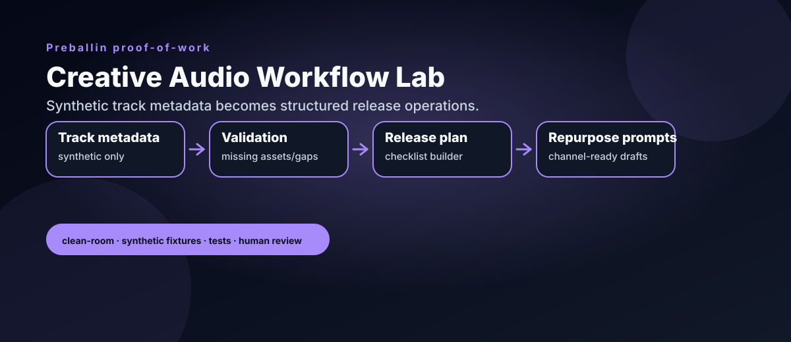

# Creative Audio Workflow Lab

Clean-room music/audio workflow utilities for synthetic track metadata, release planning, content repurposing, and AI-assisted creative operations.

This repo is designed as public proof-of-work for an AI workflow builder and creative automation operator profile. It shows how music release operations can be turned into tested, auditable, human-reviewed workflow components without exposing private assets.



## Safety boundary

This is a clean-room demo using synthetic fixtures. It does **not** include credentials, private client data, production release strategy, stems, masters, paid loops, copyrighted audio files, unreleased assets, or live execution paths.

## What it does

- Normalizes synthetic track metadata
- Validates release-prep gaps such as missing cover art or descriptions
- Builds a deterministic release checklist
- Generates channel-specific repurposing prompts
- Renders markdown reports suitable for human review
- Runs tests and CI without secrets or external services

## Example

```bash
PYTHONPATH=src python -m audio_workflow_lab.demo \
  --input examples/synthetic_tracks.json \
  --output-dir reports/generated
```

Run tests:

```bash
PYTHONPATH=src pytest -q
```

Example report excerpt:

```text
## Validation
- `cover_art_missing`
- `metadata_description_missing`
```

Generated reports include:

- `reports/generated/midnight-sketch_report.md`
- `reports/generated/sunset-bounce_report.md`

## Project layout

```text
examples/                 Synthetic track metadata only
src/audio_workflow_lab/    Workflow utilities
tests/                    Unit tests
docs/                     Safety and workflow notes
reports/generated/        Sample generated reports
```

## Recruiter-facing angle

This repo demonstrates practical AI-adjacent workflow design: structured inputs, validation, deterministic planning, prompt-safe repurposing, markdown reporting, tests, and explicit safety boundaries.

It is intentionally small, readable, and auditable.
